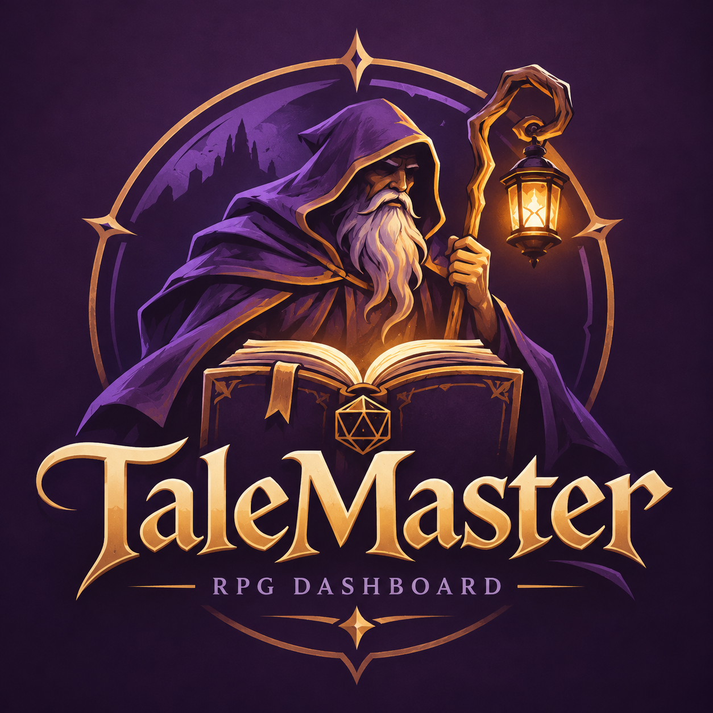

<div align="center">



# TaleMaster

**An offline-first, system-agnostic workspace for tabletop RPG campaigns.**

[Website](#) · [Getting started](#getting-started) · [Technology stack](#technology-stack) · [Architecture](#architecture-overview) · [Contributing](#contributing)

</div>

---

## About

TaleMaster is a desktop-first workspace for Game Masters to prepare, organize, document, and run tabletop role-playing campaigns.

The initial content focus is Dungeons & Dragons, while the underlying product architecture is designed to remain system-agnostic so that other tabletop RPG systems can be supported in the future.

### Product principles

- **Desktop-first:** designed primarily for a rich desktop experience.
- **Offline-first:** core campaign workflows must remain available without an internet connection.
- **Local data ownership:** campaign data belongs to the user and is stored locally.
- **Game Master-first:** tools and workflows prioritize the person preparing and running the game.
- **Optional connectivity:** local-network play is a future capability, not a requirement for the standalone application.
- **Maintainable by design:** modular boundaries, testability, and deliberate technical decisions take priority over premature abstraction.

## Project status

<sub>Early development — technical foundation in progress.</sub>

The repository currently contains the initial Angular and Electron application foundations, Nx workspace configuration, localization and visual-identity resources, and the Windows packaging pipeline.

The product features below describe the intended direction; they should not be interpreted as already implemented functionality.

### Planned capabilities

- Campaign organization and session history.
- Player and character management.
- Story and adventure documentation with rich-text editing.
- Virtual dice, modifiers, and roll history.
- Locally managed game-content library.
- Localization, initially English and Brazilian Portuguese.
- Optional host-authoritative local-network sessions in a later phase.

## Technology stack

| Area                   | Technology              | Responsibility                                                 |
| ---------------------- | ----------------------- | -------------------------------------------------------------- |
| Workspace              | Nx monorepo             | Applications, libraries, builds, and testing                   |
| Renderer               | Angular + TypeScript    | Application interface and client-side behavior                 |
| Desktop runtime        | Electron + Node.js      | Desktop lifecycle and privileged operating-system capabilities |
| UI                     | Optimus UI              | Component library                                              |
| Icons                  | OpenNG Icons            | Icon system                                                    |
| Themes                 | Optimus UI Themes       | Application theming                                            |
| Localization           | Transloco               | Translation and locale management                              |
| Rich text              | ngx-editor              | Structured rich-text editing                                   |
| Structured persistence | SQLite + better-sqlite3 | Local application data                                         |
| Unit testing           | Jest                    | Unit and integration-level tests                               |
| Packaging              | Electron Forge          | Desktop application packaging                                  |

## Architecture overview

TaleMaster separates the user interface from privileged desktop capabilities:

- **Angular renderer:** presentation, user interaction, localization, and client-side state.
- **Electron main process:** application lifecycle, database and filesystem access, operating-system integration, and authorized IPC handlers.
- **Preload bridge:** a deliberately small API exposed to the renderer. It must not expose unrestricted Node.js or filesystem access.
- **Shared libraries:** reusable domain models, rules, utilities, and application capabilities that should not depend on Angular or Electron unless their responsibility requires it.

The renderer must not access SQLite directly. Database operations belong in the Electron main process and should be exposed only through explicit, validated IPC operations.

### Local data

Structured data will be stored in SQLite. Rich-text documents, images, and attachments are intended to live in the application's local data directory, with metadata and references maintained in SQLite where appropriate. The database location will be derived from Electron's `app.getPath('userData')` rather than the installation directory.

## Repository layout

```text
apps/
├── dashboard/          # Angular renderer application
└── electron/           # Electron main process, preload, and packaging

libs/
├── i18n/               # Translation resources
└── visual-identity/    # Shared visual assets and SCSS resources
    └── assets/
        └── logos/
            └── talemaster-logo.png

.github/
└── workflows/          # GitHub Actions workflows

README.md
TODO.md
nx.json
package.json
```

This is a high-level view of the current workspace, not a promise that all future libraries already exist.

## Getting started

### Prerequisites

The current development environment uses:

- Node.js 24.x (locally validated with 24.21.0).
- npm 11.x (locally validated with 11.6.2).

Use the committed root `package-lock.json` to install the workspace dependencies consistently.

### Install dependencies

```bash
npm ci
```

### Run the Angular dashboard

```bash
npm start
```

The root start script runs the Nx dashboard development server. This starts the renderer in the browser; it is not a command for launching the packaged Electron desktop application.

### Common commands

| Command                       | Purpose                                                                      |
| ----------------------------- | ---------------------------------------------------------------------------- |
| `npm start`                   | Start the Angular dashboard development server                               |
| `npm run build`               | Build the Angular dashboard                                                  |
| `npm test`                    | Run the dashboard unit tests                                                 |
| `npm run lint`                | Lint the dashboard project                                                   |
| `npm run format`              | Apply Prettier formatting                                                    |
| `npm run format:check`        | Check formatting without changing files                                      |
| `npx nx run electron:package` | Build and package the Electron application using the configured Forge target |

The current Electron Forge configuration creates a Windows x64 ZIP package. Other operating systems and distribution formats remain to be evaluated.

## Development guidelines

- Keep domain logic independent of Angular and Electron.
- Keep privileged APIs in the Electron main process.
- Expose renderer capabilities through a restricted preload API and explicit IPC channels.
- Validate untrusted input at process boundaries.
- Use parameterized SQL statements; never interpolate untrusted values into SQL.
- Keep external content providers optional. Imported content must be usable offline and retain source and licensing metadata.
- Prefer focused, independently testable modules over broad abstractions.
- Add or update tests when changing behavior, and report only validations that were actually run.

## Contributing

TaleMaster is open source and contributions are welcome.

1. Open an issue to discuss substantial changes before investing in implementation.
2. Keep pull requests focused and explain the motivation and behavior change.
3. Include or update tests when behavior changes.
4. Run the relevant formatting, lint, test, and build checks before submitting.
5. Avoid adding dependencies or expanding scope without a clear need.

Please check the repository's open issues and discussions before starting larger work.

## License

TaleMaster is licensed under the [Apache License 2.0](LICENSE).

## Acknowledgements and trademarks

TaleMaster is an independent project. Dungeons & Dragons and related marks are the property of their respective owners; this project is not affiliated with or endorsed by Wizards of the Coast. Any third-party game content must be used in accordance with its applicable license and terms.
